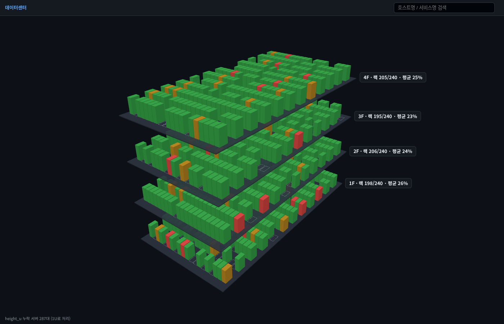
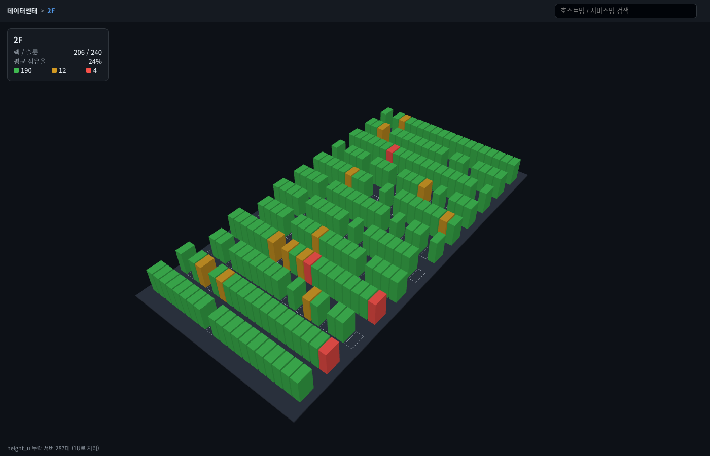
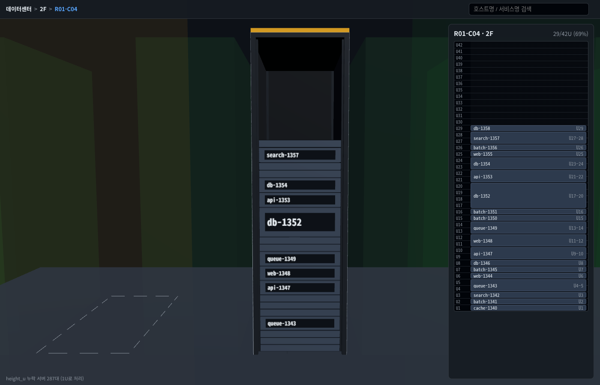
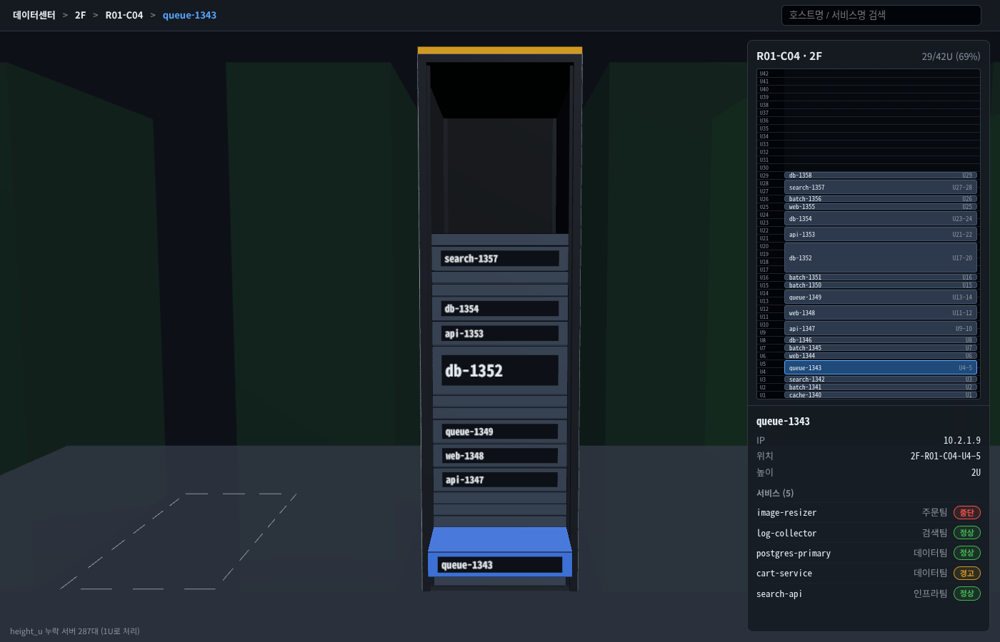
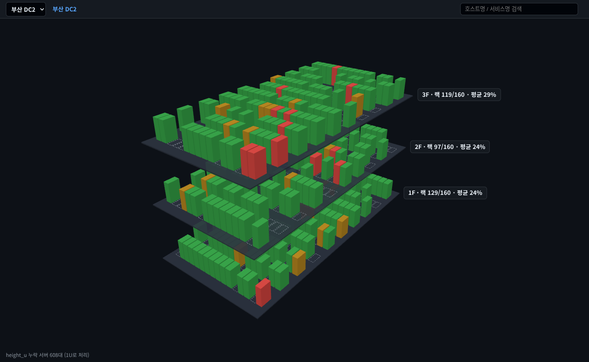

# dc-rack-3d — 데이터센터 랙/서버 3D 뷰어

정적 웹앱(Vite + three.js, vanilla JS)입니다. 중첩 JSON 하나(데이터센터 → 층 → 랙 → 서버 → 서비스)를 읽어 데이터센터를 3D로 보여 줍니다.
데이터센터가 여러 개면 상단 선택 상자로 고르며, 한 번에 선택한 데이터센터 하나만 렌더합니다.

- **overview**: 전 층을 수직으로 분해한 스택
- **floor**: 한 층의 랙 배치. 빈 슬롯은 바닥에 점선으로 표시
- **rack**: 랙을 줌인하고 U1–U42 엘리베이션 패널을 표시
- **server**: 서버 상세와 그 서버의 서비스 목록

랙 색은 U 점유율 3단계입니다: < 60% 초록, 60–85% 노랑, ≥ 85% 빨강. 서버가 없는 랙(0%)도 초록입니다.
뷰 상태 `{dc, floor, rack, server}`는 URL 해시에 기록되므로 링크로 공유할 수 있고, 브라우저 뒤로가기로 이전 화면에 돌아갑니다.

| overview | floor (2F) |
|---|---|
|  |  |
| **rack** | **server** |
|  |  |

데이터센터 선택(부산 DC2 overview):



## 실행 방법

```bash
npm install
npm run dev            # 개발 서버 (http://localhost:5173)
npm run build          # dist/ 정적 빌드
npm run preview        # 빌드 결과 미리보기 (http://localhost:4173)
npm run gen:sample     # public/data/datacenter.json 샘플 재생성 (seed 고정, 결정적)
npm test               # 단위 테스트 (Vitest)
npx playwright install chromium   # e2e 최초 1회
npm run test:e2e       # e2e (Playwright: build + vite preview, headless SwiftShader WebGL)
```

샘플 데이터는 데이터센터 3곳, 랙 1574개, 서버 10734대입니다. 서버의 약 5.7%는 `height_u`가 없어 1U로 처리됩니다.

| id | 이름 | 층 | 그리드 (행×열) | 랙 | 서버 |
|---|---|---|---|---|---|
| `seoul-1` | 서울 DC1 | 4 | 12×20 | 804 | 5205 |
| `busan-1` | 부산 DC2 | 3 | 10×16 | 345 | 2348 |
| `daejeon-1` | 대전 DC3 | 2 | 14×24 | 425 | 3181 |

층·랙·서버 ID는 데이터센터마다 새로 시작합니다(모든 DC에 `1F`, `R-1F-01-01`, `srv-00001`이 있음). 호스트명에는 DC 코드가 들어가 전체에서 유일합니다(`web-sel-0123`, `db-pus-0042`, `api-dj-0007`).

## 화면 / 조작

| 동작 | 결과 |
|---|---|
| 데이터센터 선택 상자 (상단 왼쪽, 옵션 툴팁에 층·랙·서버 수) | 그 데이터센터의 overview로 이동. 이전 데이터센터의 층·랙·라벨은 모두 해제하고 새 데이터센터를 애니메이션 없이 프리셋 카메라로 표시. 뒤로가기·해시 변경·검색 이동 후에도 항상 현재 데이터센터를 표시 |
| overview에서 층 라벨(`2F · 랙 x/y · 평균 z%`) 또는 층 바닥 클릭 | floor 모드. 다른 층은 페이드아웃 후 숨김 |
| 랙 클릭 (overview/floor) | rack 모드. 카메라가 랙 정면으로 이동하고 우측에 엘리베이션(U42→U1) 표시 |
| 다른 랙 클릭 (rack/server) | 그 랙으로 전환. 카메라 쪽 마주보는 열은 숨겨짐 |
| 서버 클릭 (3D 또는 엘리베이션 행) | server 모드. 서버가 정면으로 0.25 슬라이드되고 강조되며, 상세 패널(호스트명, 데이터센터, IP, 위치 `2F-R03-C12-U10`, 높이, 서비스/팀/상태)이 열림 |
| **ESC** / 빈 공간 클릭 | 한 단계 위로 (server → rack → floor → overview). 드래그(궤도 회전)는 클릭으로 치지 않음 (이동 < 5px, 시간 < 300ms일 때만 클릭) |
| 브레드크럼 `서울 DC1 > 2F > R03-C12 > 호스트명` | 해당 레벨로 이동. 루트는 현재 데이터센터 이름이며 그 데이터센터의 overview로 이동 |
| 검색창 (호스트명/서비스명, 대소문자 무시, 부분 일치) | 150ms 디바운스 후 최대 20건 표시. ↑/↓로 이동, Enter는 강조된 항목(기본은 첫 항목) 선택, 클릭으로도 선택. 모든 데이터센터를 검색하며, 다른 데이터센터의 결과는 보조 텍스트에 DC 이름이 붙음(`R-2F-03-12 · 부산 DC2`). 선택하면 필요 시 데이터센터를 바꾸고 해당 서버로 자동 드릴다운. 검색창 안의 ESC는 입력을 지우고 포커스를 해제하며 뷰는 그대로 둠. 결과가 없으면 "결과 없음" 표시 |
| 마우스 휠 / 드래그 | 줌 / 궤도 회전 (camera-controls) |
| hover | 랙: `R03-C12 · 2F · 31/42U (74%)`, 서버: `hostname · U10–11` |
| URL 해시 `#dc=seoul-1&floor=2F&rack=R-2F-03-12&server=srv-00123` | 그 상태로 바로 열림. 없는 ID는 가장 가까운 유효 상위 레벨로 보정. `dc`가 없는 예전 해시(`#floor=2F&rack=…`)는 첫 데이터센터 기준으로 열리고, 없는 `dc`는 첫 데이터센터의 overview로 보정(둘 다 `replaceState`로 URL 정정) |
| 브라우저 뒤로가기 | 이전 뷰 상태로 이동 (ESC를 포함한 모든 뷰 변경이 히스토리에 쌓임) |

데이터에 경고가 있으면 상단에 `⚠ N` 배지가 나타나고, 클릭하면 경로와 함께 목록이 열립니다. 치명적 오류가 있으면 `#error` 패널만 표시하고 씬은 만들지 않습니다.

## 데이터 스키마

v2 (현재 형식):

```json
{
  "version": 2,
  "datacenters": [
    { "id": "seoul-1", "name": "서울 DC1",
      "floors": [
        { "id": "2F", "level": 2, "rows": 12, "cols": 20,
          "racks": [
            { "id": "R-2F-03-12", "row": 3, "col": 12, "total_u": 42,
              "servers": [
                { "id": "srv-0123", "hostname": "web-sel-0123", "ip": "10.12.3.45",
                  "unit": 10, "height_u": 2,
                  "services": [ { "name": "payment-api", "team": "결제팀", "status": "ok" } ] } ] } ] } ] } ]
}
```

**v1 호환**: 루트에 `floors`가 있고 `datacenters`가 없으면 데이터센터 하나로 읽습니다. id는 `default`, 이름은 루트 `name`(없으면 `"데이터센터"`)입니다. 오류 경로도 예전처럼 접두사 없이(`floors[0].rows`) 표시합니다.

```json
{ "version": 1, "name": "Sample DC", "floors": [ { "id": "2F", "rows": 12, "cols": 20, "racks": [] } ] }
```

| 위치 | 필드 | 필수 | 기본값 / 비고 |
|---|---|---|---|
| 루트 | `version` | 선택 | 표시/검증에 쓰지 않음 |
| 루트 | `datacenters` | **필수** | 비어 있지 않은 배열 (v1 파일은 대신 `floors`) |
| datacenter | `id` | **필수** | 파일 전체에서 유일한 문자열 (예: `seoul-1`). 해시 `dc=`에 사용 |
| datacenter | `name` | 선택(경고) | 선택 상자·브레드크럼·서버 패널에 표시. 없으면 `id` |
| datacenter | `floors` | **필수** | 비어 있지 않은 배열 |
| floor | `id` | **필수** | 데이터센터 안에서 유일한 문자열 (예: `2F`). 해시와 라벨에 사용 |
| floor | `level` | 선택 | 아래→위 쌓는 순서. 없으면 배열 순서 |
| floor | `rows`, `cols` | **필수** | 양의 정수 (그리드 크기) |
| floor | `racks` | 선택 | 기본 `[]` |
| rack | `id` | **필수** | 데이터센터 안에서 유일한 문자열 |
| rack | `row`, `col` | **필수(경고)** | 1-based 정수, 그리드 안. 위반하면 그 랙만 제외 |
| rack | `total_u` | 선택 | 기본 42 |
| rack | `servers` | 선택 | 기본 `[]` |
| server | `id` | **필수** | 데이터센터 안에서 유일한 문자열 |
| server | `unit` | **필수** | 정수. 서버 하단의 시작 U (1-based) |
| server | `height_u` | 선택 | 기본 1 (Info로 개수만 집계) |
| server | `hostname` | 선택(경고) | 없으면 `id`로 표시 |
| server | `ip` | 선택 | |
| server | `services` | 선택 | 기본 `[]` |
| service | `name` | **필수(경고)** | 없으면 그 서비스만 제외 |
| service | `team` | 선택 | |
| service | `status` | 선택(경고) | `ok` / `warn` / `down`. 그 외 값이나 누락은 `unknown`(회색 배지) |

`rack_id` 같은 평면 참조는 필요 없습니다. 중첩 구조이므로 있어도 무시합니다.

### 검증 규칙

| 구분 | 조건 | 동작 |
|---|---|---|
| **Fatal** | fetch 실패/404, JSON 파싱 실패, `datacenters` 비배열/비어 있음, datacenter `id` 누락·중복, `floors` 비배열/비어 있음, floor `id`/`rows`/`cols` 누락, rack `id` 누락, server `id`/`unit` 누락 또는 비정수, 같은 데이터센터 안의 floor/rack/server ID 중복 | 씬을 만들지 않고 `#error`에 메시지와 경로(`datacenters[0].floors[1].racks[4].id`, v1 파일은 `floors[1].racks[4].id`) 표시 |
| Warning | datacenter `name` 누락 | `id`로 대체 |
| Warning | rack `row`/`col` 누락·비정수·그리드 밖, 같은 슬롯에 랙 중복 | 해당 랙 제외 |
| Warning | server `hostname` 누락 | `id`로 대체 |
| Warning | service `name` 누락 | 해당 서비스 제외 |
| Warning | service `status`가 허용값 외이거나 누락 | `unknown` |
| Warning | `unit < 1` 또는 `unit + height_u − 1 > total_u`, 서버 U 범위 겹침 | 렌더하되 3D와 엘리베이션에 빨간 테두리 |
| Info | `height_u` 누락 | 1U로 처리하고 개수만 표시 |

### 실데이터로 교체하기

1. 위 스키마로 JSON을 만듭니다. 다른 형식(CSV/xlsx 등)이라면 변환 스크립트가 필요합니다.
2. 다음 중 하나를 택합니다.
   - 파일을 `public/data/datacenter.json`에 두고 빌드합니다. 빌드 후라면 `dist/data/datacenter.json`을 교체해도 됩니다.
   - URL 쿼리로 지정합니다: `?data=<url>` (예: `?data=/data/real.json`, 또는 CORS가 허용된 외부 URL).
3. 화면 상단의 `⚠ N` 배지와 `#error` 패널에서 경고와 오류를 확인합니다.

**ID 규칙**: `datacenter.id`는 파일 전체에서, `floor.id`, `rack.id`, `server.id`는 각각 **같은 데이터센터 안에서** 유일한 문자열이어야 합니다. 다른 데이터센터와는 겹쳐도 됩니다(예: 모든 DC에 `1F`). 모든 조회는 현재(또는 이동할) 데이터센터 범위에서 합니다. 이 ID는 URL 해시(`encodeURIComponent`)와 내부 키로 쓰입니다. 데이터를 교체해도 ID가 같으면 공유한 링크가 계속 유효합니다. 사라진 ID는 상위 레벨로 보정됩니다. 화면 표기는 ID와 별개로 계산됩니다: 랙은 `R03-C12`, 위치는 `2F-R03-C12-U10`(2U 이상은 `U10–11`). 외부 JSON의 모든 문자열은 `textContent`로만 DOM에 들어갑니다(`innerHTML` 미사용).

## 데이터 업로드 / 편집

정적 앱이라 서버가 없습니다. 업로드한 파일과 화면에서 고친 내용은 **이 브라우저의 IndexedDB**에 저장되고, 다음 방문 때도 그대로 열립니다. 다른 사람과 공유하거나 원본 파일에 반영하려면 **JSON 내보내기**로 받은 파일을 `public/data/datacenter.json`에 넣으세요.

업로드는 **JSON**과 **CSV(엑셀)** 둘 다 됩니다. 예시 파일과 형식 설명: [`examples/upload-example.csv`](examples/upload-example.csv), [`examples/upload-example.json`](examples/upload-example.json), [`examples/README.md`](examples/README.md). CSV는 한 행이 서버 한 대이고, UTF-8과 한글 엑셀 기본 CSV(CP949) 모두 읽으며, 오류는 엑셀 행 번호로 표시합니다.

**데이터 ▾ 메뉴 (상단 오른쪽)**
- **파일 불러오기…**: `.json` 파일을 고르거나 화면 아무 곳에나 끌어다 놓습니다. 검증 규칙은 기본 파일과 같습니다. 치명 오류가 있으면 이유(경로 포함)를 보여주고 **기존 데이터는 유지**합니다. 성공하면 모든 데이터센터가 그 파일로 바뀌고 첫 데이터센터의 전체 뷰로 이동합니다.
- **JSON 내보내기** / **CSV 내보내기 (Excel)**: 현재 데이터(수정 포함)를 내려받습니다. CSV는 엑셀에서 한글이 깨지지 않도록 UTF-8 BOM을 붙입니다.
- **원본으로 되돌리기**: 브라우저에 저장된 데이터를 지우고 `public/data/datacenter.json`(또는 `?data=`)을 다시 읽습니다.
- `?data=<url>`이 있으면 저장된 데이터보다 그 URL이 우선합니다.

**편집 버튼**을 누르면 오른쪽 패널에 현재 단계의 편집 양식이 나옵니다.

| 단계 | 할 수 있는 것 |
|---|---|
| 전체 뷰 | 데이터센터 이름 변경, **층 추가**(ID·레벨·Row/Col 수, 기본값은 맨 위 층 다음 레벨 `{레벨}F`와 맨 위 층 크기, 추가 후 그 층으로 이동), **데이터센터 추가**(이름·ID·첫 층 ID·Row/Col 수, 빈 첫 층과 함께 만들고 그 데이터센터로 전환), **데이터센터 삭제**(층·랙·서버 모두, 확인 창) |
| 층 | 랙 추가: 바닥의 빈 슬롯(점선)을 클릭하면 Row/Col이 채워짐. ID를 비우면 `R-{층}-{row}-{col}`. **층 삭제**(랙·서버 포함, 확인 창) |
| 랙 | 서버 추가: 배치도의 빈 U를 클릭하면 시작 U가 채워짐. 랙 삭제(서버 포함, 확인 창) |
| 서버 | 호스트명·IP·시작 U·높이 수정, 서비스 추가/삭제/수정(이름·팀·상태), 서버 삭제(확인 창) |

편집은 저장 전에 검사합니다: U 범위(1–42)와 다른 서버와의 겹침, 같은 데이터센터 안 호스트명/랙 ID 중복, 빈 슬롯·그리드 범위, 층 ID·레벨 중복(같은 데이터센터 안), 데이터센터 ID 중복, 층 크기 1–60. 데이터센터의 마지막 층과 마지막 남은 데이터센터는 삭제할 수 없습니다(버튼이 비활성화되고 이유가 표시됨). 문제가 있으면 양식 아래에 이유가 나오고 아무것도 바뀌지 않습니다. 저장하면 3D·배치도·브레드크럼·검색이 바로 갱신되고, 카메라는 그 자리에 머뭅니다. 삭제한 서버/랙을 보고 있었다면 상위 단계로 이동합니다. 새 서버 ID는 데이터센터 안의 다음 `srv-NNNNN`입니다.

참고: 내보낸 파일에서는 `height_u`가 없던 서버도 `height_u: 1`로 채워집니다(정규화된 데이터를 저장하기 때문).

## 컨테이너 / Kubernetes 배포

정적 빌드를 비루트 nginx(`nginxinc/nginx-unprivileged`, uid 101, 포트 **8080**)로 서빙하는 이미지입니다. 업로드·편집은 브라우저 안에서만 일어나므로 서버 쪽 저장소는 필요 없습니다.

```bash
docker build -t registry.example.com/dc-rack-3d:0.1.0 .
docker run --rm -p 8080:8080 registry.example.com/dc-rack-3d:0.1.0   # http://localhost:8080
docker push registry.example.com/dc-rack-3d:0.1.0

# 클러스터 노드가 amd64이고 빌드 장비가 arm64(예: 이 장비)일 때
docker build --platform linux/amd64 -t registry.example.com/dc-rack-3d:0.1.0 .
# amd64 + arm64 멀티 아키텍처 한 태그로
docker buildx build --platform linux/amd64,linux/arm64 -t registry.example.com/dc-rack-3d:0.1.0 --push .

# k8s/dc-rack-3d.yaml 의 image / host / ingressClassName 을 바꾼 뒤
kubectl apply -n <namespace> -f k8s/dc-rack-3d.yaml
```

| 파일 | 내용 |
|---|---|
| `Dockerfile` | `node:22-alpine`에서 `npm ci` + `vite build` → nginx 이미지로 `dist/`만 복사 (최종 약 54 MB) |
| `docker/nginx.conf` | `/healthz`(프로브), gzip, `/assets/` 1년 캐시(해시 파일명), `index.html`·`/data/`는 `no-cache` |
| `k8s/dc-rack-3d.yaml` | Deployment(replica 2, 프로브, 리소스, 비루트·읽기 전용 루트 FS·capability 전부 제거, `/tmp` emptyDir) + Service(ClusterIP 80→8080) + Ingress |

- **기본 데이터 교체**: 이미지에는 샘플 `datacenter.json`이 들어 있습니다. 실데이터를 기본으로 보여주려면 빌드 전에 `public/data/datacenter.json`을 바꾸거나, Pod에서 `/usr/share/nginx/html/data`에 볼륨을 마운트하세요(매니페스트에 주석으로 예시). ConfigMap은 1 MiB 제한이 있어 큰 파일은 PVC 등을 쓰세요.
- 브라우저에서 수정한 내용은 **각 사용자 브라우저(IndexedDB)** 에만 저장됩니다. 팀 전체가 같은 데이터를 보려면 내보낸 JSON/CSV로 위 기본 데이터를 교체해 다시 배포하세요.
- TLS는 Ingress의 `tls:` 주석을 풀고 Secret 이름을 지정하면 됩니다.

## 디버그 훅

URL에 `?debug=1`을 붙이거나 dev 서버에서 실행하면 `window.__dc`가 노출됩니다. e2e 테스트는 이 훅으로 결정적 검증을 합니다.

| API | 설명 |
|---|---|
| `state()`, `mode()` | 현재 `{dc, floor, rack, server}` / `overview·floor·rack·server` |
| `currentDc()`, `dcIds()` | 현재 데이터센터 id / 파일 순서의 전체 id |
| `builtDc()`, `builtFloorIds()` | 씬에 만들어진 데이터센터 id와 그 층 id (현재 DC만 렌더) |
| `gpuMemory()` | `renderer.info.memory` (`{geometries, textures}`). DC 전환 후 해제 확인용 |
| `navigate(s)` | 해시 쓰기 (사용자 네비게이션과 같은 경로). `s.dc`가 없으면 현재 데이터센터 |
| `isSettled()` | 카메라 전환·페이드·슬라이드가 모두 끝났는지 |
| `camera()` | `{position, target}` |
| `visibleRackIds()`, `culledRackIds()`, `selectedRackId()` | 보이는 랙 / rack 모드에서 숨긴 마주보는 열 / 선택 랙 |
| `floorOpacity(id)`, `floorVisible(id)` | 층 불투명도(rack 모드 dim 포함), 가시성 |
| `rackInstanceColor(id)`, `emptySlotCount(floorId)` | 랙 색 hex, 빈 슬롯 수 |
| `rackCenter(id)`, `frontNormal(id)`, `rackScreenPos(id)`, `floorLabelScreenPos(id)` | 월드/화면 좌표 |
| `serverMeshes()`, `serverScreenPos(id)`, `unitScreenPos(u)`, `serverEmissive(id)` | 선택 랙의 서버 메시 정보 |
| `pickAt(x, y)` | 해당 화면 좌표를 클릭했을 때의 피킹 결과 `{kind, id}` |
| `revision()`, `data()` | 데이터 교체(업로드·편집) 횟수 / 현재 데이터(내보내기와 같은 형태) |
| `toScreen(p)`, `extend(obj)` | 보조 함수 |

> 이 훅은 **프로덕션 빌드에서도 `?debug=1`로 접근할 수 있습니다.** 내부용 정적 도구이고 노출되는 것이 읽기 위주 API와 일반 네비게이션뿐이므로 이를 허용했습니다(계획 ADR 참고).

## 성능

목표는 overview에서 가장 큰 샘플 데이터센터(서울 DC1, 랙 804개)를 렌더할 때 60fps입니다. 한 번에 한 데이터센터만 렌더하므로 데이터센터 수는 프레임 비용에 영향이 없습니다. 측정 노이즈를 감안해 게이트를 **≥ 55fps**로 정했습니다. 구조적 근거는 다음과 같습니다: 층별 `InstancedMesh`(draw call ≤ 5), 층당 병합 `LineSegments` 1개, CSS2D 라벨 4개, 그림자 없음, 서버 지오메트리는 선택 랙(≤ 42개)만 생성.

### 수동 FPS 게이트 (실제 GPU)

1. `npm run build && npm run preview`를 실행하고, 실제 GPU가 있는 데스크톱 Chrome에서 `http://localhost:4173/`(overview, 전체 샘플)를 엽니다.
2. DevTools → `⋮` → More tools → **Rendering** → **Frame Rendering Stats**(FPS meter)를 켭니다.
3. 마우스로 **10초간** 궤도 회전(드래그)하며 FPS를 관찰합니다.
4. 평균이 **≥ 55fps**이면 통과입니다. 결과와 머신(GPU, 해상도, devicePixelRatio)을 아래 표에 기록합니다.
5. 미달이면 아래 순서로 조정합니다(`src/scene/setup.js`, `src/scene/floors.js`).
   1. `renderer.setPixelRatio(1)`
   2. `antialias: false`
   3. overview에서 빈 슬롯 점선 숨김

| 날짜 | 머신 / GPU | 해상도 · DPR | 결과 |
|---|---|---|---|
| _(미측정. 실제 GPU 환경에서 측정 후 기록)_ | | | |

### headless 참고치 (대표성 없음)

`tests/e2e/perf.spec.js`는 overview에서 약 3초 동안 `requestAnimationFrame` 프레임 간격을 샘플링해 출력합니다. FPS 자체는 단언하지 않고 프레임이 발생했는지만 확인합니다.
headless Chromium은 **SwiftShader(CPU 소프트웨어 렌더러)**로 그리고 e2e 워커 2개가 동시에 돌기 때문에, 이 수치는 실제 성능을 **대표하지 않습니다**.

| 환경 | 결과 |
|---|---|
| headless Chromium + SwiftShader, 1280×720, 워커 2개 병렬 (2026-11-16) | 약 43–46 fps (3회 측정: 138·138·129 frames / 3.0s, frame p50 16.7ms · p95 33.3ms) |

## 테스트 커버리지

단위 테스트(Vitest) 99건, e2e(Playwright) 55건. 모든 e2e는 `afterEach`에서 콘솔 에러 0건을 확인합니다.
표기는 `파일 › 테스트 이름`입니다.

| AC | 내용 | 테스트 |
|---|---|---|
| 1 | 샘플 생성기 (DC 3곳, DC별 층 수·그리드·랙/서버 범위, 서버 합계 5000–12000, height_u 없음 3–8%, 검증 0 fatal/0 warning) | `tests/unit/schema.test.js › sample dataset › satisfies AC1`, `› generator is deterministic and matches committed file`, `› has a mix of occupancy colors and empty racks` |
| 2 | fatal/warning 규칙, 오류 패널, 경고 배지 | `tests/unit/schema.test.js › validate: fatal › *` (8건), `› validate: warnings › *` (6건), `› normalize › *`; `tests/e2e/overview-floor.spec.js › AC2 › bad JSON → #error mentions JSON`, `› missing rows → #error contains floors[0].rows`, `› overlap → no #error, warnings badge ≥ 1 with list`, `› AC13/AC2: bad service status → warning + grey status-unknown badge` |
| 3 | height_u 생략 → 1U | `tests/unit/schema.test.js › normalize › applies defaults…`, `› validate: info › counts servers without height_u`; `tests/e2e/rack.spec.js › AC10/AC3: elevation rows U42→U1, … height_u-less server spans 1 row …` |
| 4 | 층 진입 3경로에서 다른 층 opacity 0 + 숨김, visibleRackIds ⊆ f | 라벨 클릭: `tests/e2e/overview-floor.spec.js › AC18/AC4/AC7: label click enters floor…`; rack에서 브레드크럼: `tests/e2e/server-nav.spec.js › AC21 tail / AC4: … breadcrumb "2F" from rack hides other floors`; 검색: `tests/e2e/search.spec.js › AC16/AC4/AC8: from overview, hostname + Enter…`, `› AC16: service name → click…` |
| 5 | 색 3단계 경계값, 인스턴스 색 | `tests/unit/occupancy.test.js › occupancy › colorFor band boundaries`; `tests/e2e/overview-floor.spec.js › AC5: instance colors match colorFor(occupancy)…` |
| 6 | 빈 슬롯 수 | `tests/unit/slots.test.js › emptySlots = rows*cols - racks, 1-based`; `tests/e2e/overview-floor.spec.js › AC6: empty slot count…` |
| 7 | 층 요약 패널, 랙 hover 툴팁 | `tests/e2e/overview-floor.spec.js › AC18/AC4/AC7 …` (요약); `tests/e2e/rack.spec.js › AC8/AC9/AC7: click odd-/even-row rack…` (툴팁 라벨과 %); `tests/unit/occupancy.test.js › floorStats …` |
| 8 | 부드러운 카메라 전환, rack preset (target ε 0.01, position ε 0.1) | `tests/e2e/rack.spec.js › AC8/AC9/AC7: click odd-row …`, `› … even-row …`; `tests/e2e/search.spec.js › AC16/AC4/AC8 …` |
| 9 | 서버 메시 수와 y = unitToY | `tests/e2e/rack.spec.js › AC8/AC9/AC7 …`; `tests/unit/layout.test.js › unitToY` |
| 10 | 엘리베이션 42행 U42→U1, `.empty`, 빈 랙 | `tests/e2e/rack.spec.js › AC10/AC3 …`, `› AC10: empty rack shows 42 .empty rows and no meshes` |
| 11 | ESC 체인, 검색창 ESC 무시, 브레드크럼, 드래그 무시, 빈 공간 클릭, 선택 랙 빈 U 클릭 | `tests/e2e/server-nav.spec.js › AC11: ESC chain, ESC in search input ignored, breadcrumb 2F / root`, `› AC11: empty-space click server → rack → floor → overview; …drag keeps state`; `tests/e2e/rack.spec.js › AC11: empty-U click and orbit drag keep state; empty-space click → floor`; `tests/e2e/search.spec.js › ESC in search clears the input…`; `tests/unit/store.test.js › up() chain`, `› goLevel` |
| 12 | 3D(마주보는 열 포함)와 엘리베이션 클릭 → 패널 | `tests/e2e/server-nav.spec.js › AC12/AC14: 3D click on a server of an interior rack…`, `› AC12: elevation block click → server panel` |
| 13 | 서비스 이름/팀/배지 `status-ok/warn/down` (+ `unknown`) | `tests/e2e/server-nav.spec.js › AC13: services listed with name, team and status badge`; `tests/e2e/overview-floor.spec.js › AC2 › AC13/AC2: bad service status → … status-unknown badge`; `tests/unit/schema.test.js › validate: warnings › service name missing / bad status` |
| 14 | 선택 서버 offset 0.25, 나머지 0, ESC 후 모두 0 | `tests/e2e/server-nav.spec.js › AC12/AC14 …`, `› AC12: elevation block click …` (전환 중 미정착 확인), `› AC20 …` |
| 15 | 호스트명/서비스명 부분 일치, 대소문자 무시, ≤ 20 | `tests/unit/search.test.js › hostname match`, `› service match, case-insensitive`, `› dedupes server matching both as hostname`, `› limit and empty query`; `tests/e2e/search.spec.js › AC15: partial hostname → ≤20 hostname results…; service name → service results`, `› ↑/↓ moves the active item (wraps); outside click closes` |
| 16 | 검색 → 서버로 드릴다운, 다른 층 숨김, AC8 카메라 (overview에서 직접 진입 포함) | `tests/e2e/search.spec.js › AC16/AC4/AC8: from overview, hostname + Enter…`, `› AC16: service name → click a (non-first) result…`, `› ↑/↓ moves … (Enter는 강조 항목)` |
| 17 | 초기 overview, 층 라벨 4개 | `tests/e2e/overview-floor.spec.js › AC17: initial overview with 4 floor labels from floorStats`; `tests/unit/occupancy.test.js › floorStats avg includes empty racks` |
| 18 | 층 진입 중 페이드 관측, 정착 후 0 + 숨김 | `tests/e2e/overview-floor.spec.js › AC18/AC4/AC7 …`, `› floor → overview restores all floors; summary hidden` |
| 19 | overview에서 랙 클릭 → rack 모드 | `tests/e2e/rack.spec.js › AC19: overview rack click → rack mode, same id`; `tests/unit/store.test.js › openRack from overview sets floor` |
| 20 | 해시 roundtrip, 없는 ID → 상위, reload, goBack | `tests/unit/hash.test.js › *` (4건); `tests/unit/store.test.js › invalid ids fall back to nearest ancestor with replaceState`, `› server-only hash resolves full chain…`, `› bindHash …`; `tests/e2e/server-nav.spec.js › AC20: reload restores server state; goBack → previous; invalid rack → floor ancestor` |
| 21 | rack 모드에서 다른 랙 클릭 → 전환, 메시 재생성, ESC → floorOpacity 1 | `tests/e2e/rack.spec.js › AC21: click a faded same-row neighbour…`; `tests/e2e/server-nav.spec.js › AC21 tail / AC4 …`, `› AC11: empty-space click … (floorOpacity 1)` |
| US-004/005 편차 | 랙 material만 dim, 마주보는 열 숨김/피킹 제외 | `tests/e2e/server-nav.spec.js › AC12/AC14 …` (`culledRackIds` = 카메라 쪽 열), `› AC21 tail / AC4 …` (floor 복귀 시 culled 0), `tests/e2e/rack.spec.js › AC11 …` (culled 랙 자리 클릭 = 빈 공간) |
| DC-1 | v2 스키마, v1 호환, DC id 필수·중복 fatal, name 누락 경고, ID 유일성은 DC 안에서만, 경로 접두사 | `tests/unit/schema.test.js › v2 datacenters › *` (7건); `tests/e2e/datacenter.spec.js › legacy v1 single-DC file loads as dc "default" and its legacy hash works` |
| DC-2 | 상태 `{dc,…}`, 해시 `dc=`, dc 없음/없는 dc → 첫 DC, DC 범위 조회, `selectDc`, `up`/`goLevel('root')` | `tests/unit/hash.test.js › *`; `tests/unit/store.test.js › no dc → first DC…`, `› unknown dc → first DC overview`, `› lookups are scoped to the target DC`, `› selectDc navigates…`, `› up() chain stays in the DC…`, `› goLevel (root = current DC overview)`; `tests/e2e/datacenter.spec.js › unknown dc falls back…`, `› legacy hash without dc opens the first DC`, `› deep link #dc=daejeon-1&floor=2F&rack=<id> opens that rack` |
| DC-3 | 현재 DC만 렌더, 전환 시 해제(남은 라벨 0, GPU 메모리 복귀), 카메라 프리셋이 실제 층 크기·층 수에 맞춤 | `tests/unit/layout.test.js › floorFootprint / stackExtent…`, `› camera presets scale with floor size and floor count`; `tests/e2e/datacenter.spec.js › switch to busan-1: 3 floor labels…`, `› camera frames the stack (overview) and daejeon-1 larger floors (floor mode corner racks)` |
| DC-4 | 선택 상자(이름, 수량 툴팁), 뒤로가기 후에도 동기화, 브레드크럼 루트 = DC 이름, 서버 패널 "데이터센터" 행 | `tests/e2e/datacenter.spec.js › selector lists the 3 DCs…`, `› switch to busan-1 … back restores seoul-1`, `› rack/server state survives a switch away and back…`, `› breadcrumb root shows the DC name and goes to that DC overview` |
| DC-5 | 전체 DC 검색, 다른 DC 결과에 DC 이름, 선택 시 DC 전환 | `tests/unit/search.test.js › buildIndex entries span every DC…`, `› results from another DC show the DC name in sub`; `tests/e2e/datacenter.spec.js › search finds a hostname that only exists in another DC…` |
| ED-1 | 편집 연산(불변, U 겹침/범위, 호스트명·랙 ID 중복은 DC 안에서만, 슬롯 검사, 서비스 정리), `setData`(상태 재해석·revision·항상 알림), `worldToGrid` | `tests/unit/edit.test.js › *` (17건, 층/데이터센터 추가·삭제 포함); `tests/unit/store.test.js › setData: …`, `› setData reset …`; `tests/unit/layout.test.js › worldToGrid …` |
| ED-2 | 업로드(파일 선택·드래그), 잘못된 파일은 오류만 표시하고 기존 데이터 유지, 새로고침 후 유지, 원본으로 되돌리기, 내보내기 | `tests/e2e/edit.spec.js › upload a valid file …`, `› upload an invalid file …`, `› drag-and-drop …`, `› rename a DC …; export downloads the edited JSON` |
| ED-3 | 서버/서비스 수정·추가·삭제, 랙 추가(빈 슬롯 클릭)·삭제, 잘못된 입력 거부, 편집 중 ESC 무시 | `tests/e2e/edit.spec.js › edit a server …`, `› invalid server edit …`, `› add a server from an empty U …`, `› delete a rack …`, `› floor edit mode: clicking an empty slot …`, `› add a floor on top of the stack …`, `› add a datacenter …`, `› delete a floor …`, `› last floor and last DC cannot be deleted …`, `› delete a datacenter …` |
| ED-4 | CSV: 따옴표·구분자·인코딩(UTF-8 BOM, CP949), 행 → DC/층/랙/서버 묶기, 빈 랙·빈 층 행, 한글 헤더, 엑셀 행 번호 오류, 검증 경로 → 행 번호, CSV 내보내기 왕복 | `tests/unit/csv.test.js › *` (11건); `tests/e2e/edit.spec.js › CSV upload (Excel, CP949 too) …` |
| 성능 | headless FPS 기록 (단언 없음) | `tests/e2e/perf.spec.js › perf (informational)…` + 위 수동 게이트 |

빠진 항목: 실제 GPU에서의 ≥ 55fps 게이트는 자동화할 수 없어 수동 절차로 남겨 두었습니다(위 "성능" 참고).

## 계획 대비 변경점

원래 스펙 대비 의도적으로 바꾼 것들입니다(`.omc/PLAN.md` ADR 결과 항목과 구현 중 수용한 편차).

- **중첩 스키마**: 스펙 초안의 평면 `server.rack_id` 대신 층 → 랙 → 서버 → 서비스 중첩 구조를 씁니다. floor에 `id`/`level`이 추가되었습니다.
- **해시는 층 ID 사용**: `#floor=2F` (스펙의 `floor=2` 대신)
- **0% 랙도 초록**: 빈 랙에 별도 회색 처리는 없습니다.
- **뒤로가기**: ESC를 포함한 모든 뷰 변경이 히스토리에 쌓이므로, 브라우저 뒤로가기는 뷰 히스토리를 한 단계씩 거슬러 갑니다.
- **의존성 +1**: 카메라 궤도와 전환에 `camera-controls`를 씁니다(자작 tween 대신).
- **FPS 게이트 55fps**: 스펙 목표는 60fps이며, 측정 노이즈를 감안해 수동 게이트를 55fps로 정했습니다.
- **`?debug=1`이 프로덕션에서도 동작**: 내부 도구라 허용했습니다(위 "디버그 훅").
- **rack 모드 dim 범위**: 층의 랙 material만 0.15로 흐려지고 바닥·점선은 그대로입니다. 뽑아낸 선택 랙과 서버는 `transparent(opacity 1) + renderOrder 1`로 페이드된 랙 뒤에 그려져 색이 물들지 않게 했습니다. `floorOpacity(id)`는 fade × dim입니다.
- **마주보는 열 숨김**: rack/server 모드에서 카메라와 선택 랙 사이의 마주보는 열(카메라 쪽 랙)은 zero-scale로 숨겨지고 피킹·hover 대상에서 빠집니다. 원래는 그 열이 흐리게 남아 화면을 가렸기 때문에, "빈 공간 클릭"이 거의 동작하지 않고 클릭이 그 열의 랙으로 전환되었습니다.
- **없는 `dc`는 첫 데이터센터의 overview로**: `dc`가 없는 예전 해시는 floor/rack/server를 첫 데이터센터에서 그대로 찾지만, 없는 `dc`가 붙은 해시는 하위 ID를 버립니다. 층·랙 ID가 데이터센터마다 겹치므로(`R-1F-01-01`), 다른 데이터센터를 가리키던 하위 ID를 첫 데이터센터에 적용하면 엉뚱한 랙이 열리기 때문입니다.
- **데이터센터 전환은 애니메이션 없음**: 새 데이터센터는 해당 모드의 프리셋 위치에 바로 나타납니다(같은 데이터센터 안의 이동만 애니메이션).
- **e2e 뷰포트 1280×720**: 흔한 노트북 해상도로 의도적으로 정했습니다. 이전 설정은 `devices['Desktop Chrome']` spread가 1400×900 지정을 덮어써 사실상 1280×720으로 돌고 있었는데, 이를 spread 뒤에 명시해 바로잡았습니다.
